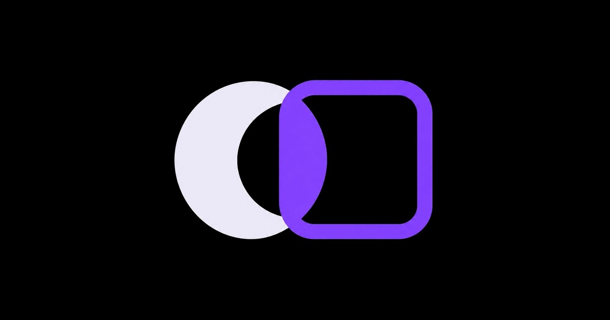

<a href="https://zeronym.lat"></a>

<h1 align="center">Zeronym</h1>
<p align="center"><strong>Your assets. Your information. Your choice.</strong></p>

<p align="center">
  <a href="https://zeronym.lat/app/">Open the app</a> &nbsp; / &nbsp;
  <a href="https://zeronym.lat/docs/">Product docs</a> &nbsp; / &nbsp;
  <a href="docs/GETTING_STARTED.md">Get started</a> &nbsp; / &nbsp;
  <a href="docs/ARCHITECTURE.md">Architecture</a>
</p>

<p align="center">
  <a href="https://github.com/Zeronym-Developer/Zeronym/actions/workflows/site.yml"></a>
  <a href="https://github.com/Zeronym-Developer/Zeronym/actions/workflows/deployments.yml"></a>
  <a href="https://github.com/Zeronym-Developer/Zeronym/actions/workflows/proof-assets.yml"></a>
  <a href="https://github.com/Zeronym-Developer/Zeronym/actions/workflows/contracts.yml"></a>
  <a href="https://github.com/Zeronym-Developer/Zeronym/actions/workflows/client.yml"></a>
  <a href="https://github.com/Zeronym-Developer/Zeronym/actions/workflows/pool.yml"></a>
</p>

Zeronym is a shielded USDG pool on Robinhood Chain mainnet. Deposit from your wallet, send privately inside the pool, and withdraw to a public address. Private transfers publish commitments, encrypted notes and a zero-knowledge proof, without publishing the private sender, recipient or payment amount.

This repository contains the contracts, Circom circuit, browser app, relayer and independent verification script used by Zeronym.

## What you can do

| Feature | How it works |
| --- | --- |
| **Shield USDG** | Deposit into the pool from your wallet. Pay with ETH to swap into USDG through Uniswap before shielding. |
| **Send privately** | Pay a `zn1…` shielded address. The recipient decrypts the payment and optional note on their device. |
| **Receive with a link** | Share a personal payment link or request a set amount. Request amounts and notes stay in the URL fragment, outside the HTTP request. |
| **Organize private vaults** | Separate notes into Savings, Trading or other compartments. Vault names stay on your device. |
| **Share a receipt** | Disclose a payment record or viewing key to someone who needs it, without giving them spending access. |
| **Withdraw** | Receive USDG at a public address, or swap the withdrawal into ETH through the ETH exit contract. |

The optional relayer submits private actions and pays network gas for a **0.50 USDG** fee. There is no protocol fee and no token-holding requirement to use the pool.

## How a private payment works

1. **Find the notes.** Your app reads pool events directly from the chain, decrypts your notes and rebuilds the Poseidon Merkle tree. There is no indexer.
2. **Build the payment.** It selects up to two input notes and creates two outputs for the recipient and change.
3. **Prove locally.** A browser worker produces a Groth16 proof using the shipped circuit files. Spending keys and private proof inputs stay on your device.
4. **Submit.** The relayer pays the gas and calls the pool. The proof binds the public transaction data, including encrypted outputs and the relayer fee.
5. **Verify and receive.** The contract checks the proof, rejects spent nullifiers and records the new commitments. The recipient finds and decrypts their new note.

Deposits and withdrawals remain public, including their addresses, amounts and timing. Relayers and RPC providers can see network metadata. Privacy grows as more people use the pool. See [what stays private](https://zeronym.lat/docs/privacy/).

## Explore the code

| Area | What is included |
| --- | --- |
| [Pool contracts](contracts/pool/contracts) | Pool, Merkle tree, Groth16 verifier and the ETH exit helper |
| [Circuit](contracts/pool/circuits) | Two inputs, two outputs and a 20-level Poseidon Merkle tree; each note includes its asset |
| [Client library](contracts/pool/lib) | Key derivation, shielded addresses, note encryption, commitments, nullifiers and proof inputs |
| [App](apps/site/src/app) | Shield, send, receive, withdraw, private vaults, receipts and recovery |
| [Worker](apps/site/worker) | Relayer, live pool statistics and waitlist endpoints |
| [Prover files](apps/site/public/zk) | Browser WASM and proving key, named by content hash |
| [Verification](apps/site/public/verify/verify-mainnet.mjs) | Read-only checks of deployed admin powers, pool transactions and every published proof |
| [Tests](contracts/pool/test) | Real Groth16 proofs on a local chain, plus ETH exit tests against a mainnet fork |

The pool follows Tornado Nova's design with an asset field on each note. Note encryption uses X25519 and AES-GCM. See the [architecture guide](docs/ARCHITECTURE.md) for the components and trust boundaries.

## Run locally

Use **Node.js 24**. The pinned Astro release requires Node.js 22.22.0 or newer.

```sh
cd apps/site
npm ci
ZERONYM_NETWORK=mainnet SITE_URL=https://zeronym.lat npm run dev
```

Open the local URL printed by Astro. Keep `ZERONYM_NETWORK=mainnet` set when building or serving this deployment.

```sh
ZERONYM_NETWORK=mainnet npm run check
ZERONYM_NETWORK=mainnet SITE_URL=https://zeronym.lat npm run build
```

The build goes to `apps/site/dist`. Relayer and live pool endpoints run in the separate Cloudflare Worker. Setup, local proof tests and Worker configuration are covered in [Getting started](docs/GETTING_STARTED.md).

## Checks on every push

Six workflows run on pushes and pull requests. Their badges above show GitHub's current results.

| Workflow | What it checks |
| --- | --- |
| Site build | Mainnet production build on Node.js 22 and 24 |
| Deployment records | Agreement between the app, pool records and public verification script |
| Prover assets | Bundled WASM and proving key integrity |
| Contract build | Solidity compilation and the expected pool interface |
| Client cryptography | Client-side keys, notes and proof-related primitives |
| Pool integration | Deposits, private payments, withdrawals and rejected invalid spends using real proofs |

To run the pool tests from the repository root:

```sh
node scripts/ci/install-pool.mjs
npm --prefix contracts/pool run compile
node scripts/ci/prepare-prover.mjs
npm --prefix contracts/pool test
```

The tests deploy to a local chain and use the bundled mainnet prover files. They do not send transactions to mainnet. Successful CI demonstrates these checks passed; it does not establish a security audit.

## Mainnet contracts

**Network:** Robinhood Chain · **Chain ID:** 4663

| Contract | Address |
| --- | --- |
| Shielded pool | [`0x84c21f20959f0d00892007f2a7cfe46d19077877`](https://robinhoodchain.blockscout.com/address/0x84c21f20959f0d00892007f2a7cfe46d19077877) |
| Verifier | [`0xa1cb0bf67c66749bd6075ead69fb1ede77757101`](https://robinhoodchain.blockscout.com/address/0xa1cb0bf67c66749bd6075ead69fb1ede77757101) |
| Poseidon hasher | [`0xc94243f257b9ac32a458d73fad37f46fcd0202e1`](https://robinhoodchain.blockscout.com/address/0xc94243f257b9ac32a458d73fad37f46fcd0202e1) |
| ETH exit | [`0xcf05a3b5e418dd0afe3ffb075f7b64c27019bb63`](https://robinhoodchain.blockscout.com/address/0xcf05a3b5e418dd0afe3ffb075f7b64c27019bb63) |
| Admin, 2-of-3 Safe | `0xFB4ff79d6BD9563b9f9c85Ce0Aa16271eA904Ae3` |
| USDG | `0x5fc5360d0400a0fd4f2af552add042d716f1d168` |
| Znym token | [`0x157ba872a92c2f147c3ea73dabf56daa9ef8fc67`](https://robinhoodchain.blockscout.com/token/0x157ba872a92c2f147c3ea73dabf56daa9ef8fc67) |

The pool, verifier and ETH exit have source verification on [Sourcify](https://sourcify.dev/server/v2/contract/4663/0x84C21F20959F0D00892007f2A7cFe46d19077877) and Blockscout. Deployment addresses, transaction hashes and prover hashes are recorded in [`contracts/pool/deployments/mainnet.json`](contracts/pool/deployments/mainnet.json).

The pool is not upgradeable. Its admin can enable or disable new deposits of an asset and transfer the admin role. It cannot block withdrawals, move funds, change the verifier or charge a protocol fee.

The Znym token is the Pons launchpad's standard token contract and is not part of this source tree. The pool does not depend on it.

## Verify independently

The [mainnet verification script](apps/site/public/verify/verify-mainnet.mjs) needs no wallet or private key. It reads the deployed admin configuration, examines pool transactions and calls the verifier again for every proof. Each proof is also checked with a changed public input, which must be rejected.

After installing the site dependencies, run from the repository root:

```sh
node apps/site/public/verify/verify-mainnet.mjs
# Machine-readable output:
node apps/site/public/verify/verify-mainnet.mjs --json
```

It uses Robinhood Chain's public RPC by default. An optional `RPC_URL` environment variable selects another endpoint. See the [verification guide](https://zeronym.lat/docs/verify/) for the scope of these checks.

The proving setup uses PSE perpetual powers of tau for phase 1, four phase 2 contributions and the hash of Robinhood Chain block **98,488,820** as the public beacon.

## Contributing and security

Read [CONTRIBUTING.md](CONTRIBUTING.md) before opening a pull request. Report vulnerabilities privately to **support@zeronym.lat**, as described in [SECURITY.md](SECURITY.md).

A project-wide source license has not been selected. This code is published for review; third-party code retains its own notices and license terms.

[Website](https://zeronym.lat) · [Docs](https://zeronym.lat/docs/) · [X](https://x.com/zeronym_app) · [Telegram](https://t.me/Zeronym_pro)
